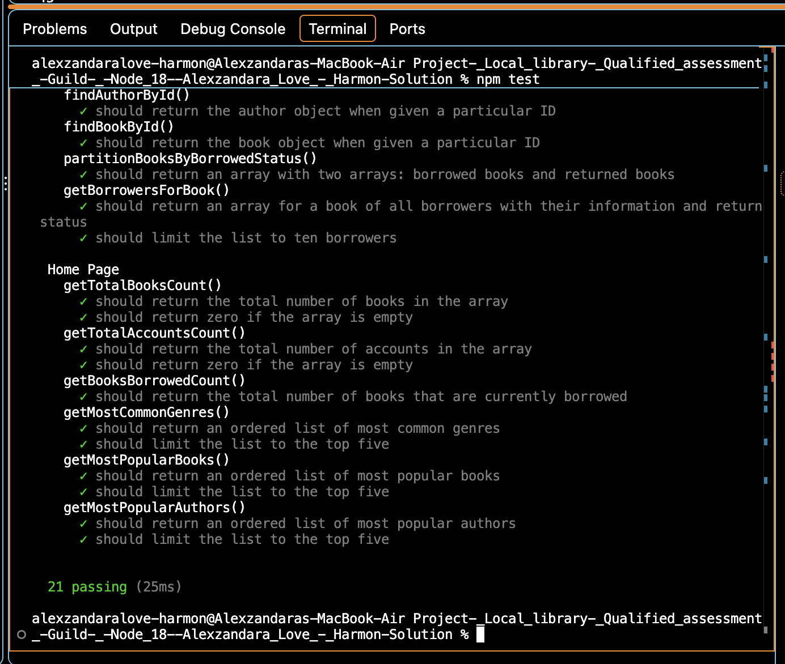

# Local Library Capstone

## Project Overview

This project deploys JavaScript functions for a local library's admin's dashboard. The functions processes books, authors, accounts, and borrowing records.

## Project Plan

1. Review the project requirements and starter code files.
2. Identify the functions that require implementation.
3. Implement and test each function as I go.
4. Debug failing tests and correct until passed.
5. Document the completed project and publish it to GitHub from my preferred IDE which is VS Code.

## Implementation

- `home.js`: Calculates the library totals and the number of borrowed books.
- `accounts.js`: Finds accounts, sorts the accounts by the last name, and formats the full names.
- `books.js`: Finds the books and the authors by ID.

I used JavaScript that includes the "find()", "filter()", "map()", and "sort()" array methods.

## Testing

I ran the automated tests using `npm test` and also connected Jest as an alternative.

**Final result: 21 passing, 0 failing.**

- I conducted these test multiple times debugging until all passed appropriately.

## Challenges and Solutions

- Resolved issues with determining whether books were currently borrowed.
- Corrected function implementations based on failing tests.
- Used Node.js 18 to run the project via my VS Code terminal.
- Verified updated changes through repeated test runs.

## Development Decisions

I implemented the required functions within the existing project structure rather than modifying unrelated application files.

I used array methods to keep the code concise and readable.

## AI Assistance

I used ChatGPT to help interpret requirements, troubleshoot errors, explain JavaScript methods, and develop function implementations.

I reviewed the suggested changes and used the project's automated tests to verify the results.

## Development Process Summary

I decided to approach the project incrementally, implementing the required functions and running tests to identify problems as I worked my way through deugging. I began with the dashboard calculations, and then completed the account functions and then the book and author lookup functions.

One challenge involved determining whether a book was currently borrowed. After reviewing the test results, I updated the implementation to check the most recent borrowing record to solve the problem.

I also encountered setup and Git configuration issues, which I addressed while preparing the project for submission and grading.

The project reinforced my understanding of JavaScript array methods, debugging, and version control.

## Navigation Structure

The library application uses three main pages:

- Home ("index.html") — Displays library statistics.
- Accounts ("accounts.html") — Displays registered library accounts.
- Books ("books.html") — Displays library books and borrowing information.

This is a reasoonable navigation form because it groups related information into identified pages and allows users to access the main library functions as designed.

## Algorithm and Implementation Decisions

I organized my implementation around the three existing JavaScript files:

- "home.js" — Count the books, the accounts, and the borrowed books.
- "accounts.js" — Find the accounts, sort by the last name, and generate the full names.
- "books.js" — Find authors and books using their IDs.

I used "find()" for matching records, "filter()" for borrowed books, "map()" for transforming account data, and "sort()" for alphabetical ordering.

I used the "spread operator" when sorting accounts to avoid changing the original array.

## Coding Trade-offs

I chose JavaScript array methods instead of manually writing loops for every single operation.

These methods improve readability and reduce time and the amount of code required. One trade-off is that methods such as "find()" and "filter()" may evaluate multiple records, but they were appropriate for this project's requirements.

## Challenges and Troubleshooting

One challenge was calculating the number of the borrowed books correctly. My initial approach checked the borrowing records differently from the project's expected current-status configuration.

I corrected the function to check the first borrowing record and confirmed the result using automated tests in my native terminal.

I also resolved a Node.js version requirement and corrected a Git remote URL before successfully pushing the project to GitHub.

## Development Evidence

The GitHub commit history documents the completed implementation, README documentation, and test screenshot.

Screenshot:

I did not use Replit for this exercise, only VS Code.
